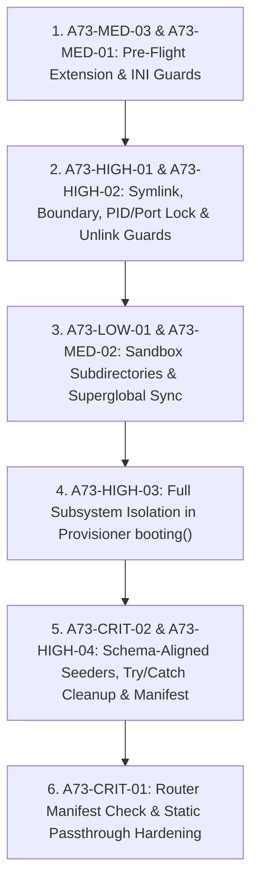

# AUDIT-74 — Corrective Plan for Stage 1 Security Findings

**Project:** HouseFix360 CRM (`D:\xampp-8.2\htdocs\crms`)  
**Audit Reference:** AUDIT-74  
**Date:** 2026-10-28  
**Status:** Complete (Read-Only Remediation Plan for Stage 1 Scripts)  

---

## 1. Executive Summary & Mandatory Safety Certification

This report provides a complete, line-accurate remediation plan for all unresolved risks, safety gaps, and implementation vulnerabilities identified across [AUDIT_73_STAGE_1_SCRIPTS_SECURITY_REVIEW.md](file:///D:/xampp-8.2/htdocs/crms/AUDIT_73_STAGE_1_SCRIPTS_SECURITY_REVIEW.md), [tests/browser_server_router.php](file:///D:/xampp-8.2/htdocs/crms/tests/browser_server_router.php), and [tests/provision_browser_qa_db.php](file:///D:/xampp-8.2/htdocs/crms/tests/provision_browser_qa_db.php).

While AUDIT-73 explicitly documented two unresolved runtime risks in **Section 8.2** (`§8.2.1` and `§8.2.2`) and an external CLI flag dependency in **Section 6.1** (`§6.1`), a strict static re-verification of the code blocks audited in AUDIT-73 **Sections 2 through 8** against the actual codebase models ([app/Models/User.php](file:///D:/xampp-8.2/htdocs/crms/app/Models/User.php), [app/Models/Role.php](file:///D:/xampp-8.2/htdocs/crms/app/Models/Role.php), [app/Models/PaymentMethod.php](file:///D:/xampp-8.2/htdocs/crms/app/Models/PaymentMethod.php), [app/Models/Project.php](file:///D:/xampp-8.2/htdocs/crms/app/Models/Project.php)) and seeders ([database/seeders/PermissionSeeder.php](file:///D:/xampp-8.2/htdocs/crms/database/seeders/PermissionSeeder.php), [database/seeders/RoleSeeder.php](file:///D:/xampp-8.2/htdocs/crms/database/seeders/RoleSeeder.php)) uncovered **10 total findings** (2 Critical, 4 High, 3 Medium, 1 Low) that must be remediated in the two Stage 1 scripts before Stage 2 can be safely approved.

### Mandatory Operational Safety Certification
- **Read-Only Inspection & Planning Only:** Neither [tests/browser_server_router.php](file:///D:/xampp-8.2/htdocs/crms/tests/browser_server_router.php) nor [tests/provision_browser_qa_db.php](file:///D:/xampp-8.2/htdocs/crms/tests/provision_browser_qa_db.php) nor any existing project file was modified.
- **Zero Command or Script Execution:** No PHP, Artisan, Tinker, PHPUnit, SQL, migrations, seeders, or provisioning commands were executed.
- **Zero Database Access:** Persistent databases `crms`, `admin_crms`, `admin_crm_demo`, and `browser_qa.sqlite` were never created, opened, queried, or modified.
- **Zero Server or Browser Processes:** No HTTP servers or browser processes were started or stopped.
- **Full Preservation:** `.env`, `demo/`, Git state, and all prior audit reports (`AUDIT-55` through `AUDIT-73`) remain completely untouched.

---

## 2. Master Finding Inventory & Detailed Remediation Specifications

Every finding below lists its **Original AUDIT-73 Reference ID** (mapping directly to the section and line in [AUDIT_73_STAGE_1_SCRIPTS_SECURITY_REVIEW.md](file:///D:/xampp-8.2/htdocs/crms/AUDIT_73_STAGE_1_SCRIPTS_SECURITY_REVIEW.md)) alongside a structured remediation tracking code (`A73-*`).

| Original AUDIT-73 ID | Remediation ID | Severity | Classification | Affected File & Lines | Summary |
| :--- | :--- | :--- | :--- | :--- | :--- |
| **AUDIT-73 §2.1-Step2** (`L53-L55`) | `A73-CRIT-01` | **CRITICAL** | Confirmed Vulnerability | [tests/browser_server_router.php:L81-L89](file:///D:/xampp-8.2/htdocs/crms/tests/browser_server_router.php#L81-L89) | Static asset passthrough permits `/index.php` execution and uncanonicalized path traversal before the 4-tier gatekeeper runs. |
| **AUDIT-73 §3-Seeders** (`L112-L125`) | `A73-CRIT-02` | **CRITICAL** | Confirmed Vulnerability / Defect | [tests/provision_browser_qa_db.php:L274-L372](file:///D:/xampp-8.2/htdocs/crms/tests/provision_browser_qa_db.php#L274-L372) | Provisioner seeds non-existent table `role_user` (actual: `user_roles`), non-existent columns (`payment_methods.status`, `projects.client_name`), and mismatched permission keys. |
| **AUDIT-73 §2.1-Step0/7 & §4.3-4.6** (`L41-L45`, `L78-L85`, `L147-L154`) | `A73-HIGH-01` | **HIGH** | Confirmed Vulnerability / Safety Gap | [tests/browser_server_router.php:L44-L55](file:///D:/xampp-8.2/htdocs/crms/tests/browser_server_router.php#L44-L55), [L144-L208](file:///D:/xampp-8.2/htdocs/crms/tests/browser_server_router.php#L144-L208) & [tests/provision_browser_qa_db.php:L88-L99](file:///D:/xampp-8.2/htdocs/crms/tests/provision_browser_qa_db.php#L88-L99) | Router omits symlink/junction rejection (`is_link`), canonical `storage/testing/` boundary check, and 16-byte SQLite header check; provisioner omits `is_link($testingDir)`. |
| **AUDIT-73 §4.1 & §5.2** (`L142-L144`, `L176-L179`) | `A73-HIGH-02` | **HIGH** | Conditional Risk / Safety Gap | [tests/provision_browser_qa_db.php:L61-L78](file:///D:/xampp-8.2/htdocs/crms/tests/provision_browser_qa_db.php#L61-L78), [L120-L136](file:///D:/xampp-8.2/htdocs/crms/tests/provision_browser_qa_db.php#L120-L136) | PID check fails open if `server.pid` is non-numeric/empty or `shell_exec` fails; `@unlink` suppresses lock failures without verifying deletion before `touch()`. |
| **AUDIT-73 §3 & §6.2-6.5** (`L110-L135`, `L189-L198`) | `A73-HIGH-03` | **HIGH** | Confirmed Safety Gap | [tests/provision_browser_qa_db.php:L171-L185](file:///D:/xampp-8.2/htdocs/crms/tests/provision_browser_qa_db.php#L171-L185) | Provisioner `$app->booting()` only locks `database`, omitting `logging`, `cache`, `queue`, `mail`, `broadcasting`, `filesystems.disks.public`, and `Http::preventStrayRequests()`. |
| **AUDIT-73 §8.2-2** (`L235`) | `A73-HIGH-04` | **HIGH** | Runtime-Only Uncertainty & Safety Gap | [tests/provision_browser_qa_db.php:L245-L256](file:///D:/xampp-8.2/htdocs/crms/tests/provision_browser_qa_db.php#L245-L256), [L378-L394](file:///D:/xampp-8.2/htdocs/crms/tests/provision_browser_qa_db.php#L378-L394) & [tests/browser_server_router.php:L46](file:///D:/xampp-8.2/htdocs/crms/tests/browser_server_router.php#L46) | Uncaught migration/seeder exceptions leave a partial non-zero-byte `browser_qa.sqlite` on disk that passes router Step 0 (`filesize > 0`). |
| **AUDIT-73 §6.1** (`L188`) | `A73-MED-01` | **MEDIUM** | Conditional Risk | [tests/browser_server_router.php:L44-L55](file:///D:/xampp-8.2/htdocs/crms/tests/browser_server_router.php#L44-L55) | Router relies on external CLI `-d allow_url_fopen=0` flag to block `@file_get_contents()` in `GpsTrackingValidationService.php` without asserting `ini_get('allow_url_fopen')` at runtime. |
| **AUDIT-73 §2.1-Step1** (`L48-L50`) | `A73-MED-02` | **MEDIUM** | Conditional Risk | [tests/browser_server_router.php:L60-L79](file:///D:/xampp-8.2/htdocs/crms/tests/browser_server_router.php#L60-L79) & [tests/provision_browser_qa_db.php:L141-L160](file:///D:/xampp-8.2/htdocs/crms/tests/provision_browser_qa_db.php#L141-L160) | Only 3 of 11 `putenv()` overrides are mirrored into `$_ENV` and `$_SERVER`, leaving `APP_CONFIG_CACHE` and secondary drivers vulnerable to pre-populated superglobals. |
| **AUDIT-73 §8.2-1** (`L234`) | `A73-MED-03` | **MEDIUM** | Runtime-Only Uncertainty | [tests/browser_server_router.php:L44](file:///D:/xampp-8.2/htdocs/crms/tests/browser_server_router.php#L44) & [tests/provision_browser_qa_db.php:L58](file:///D:/xampp-8.2/htdocs/crms/tests/provision_browser_qa_db.php#L58) | Neither script verifies `extension_loaded('pdo_sqlite')` and `extension_loaded('sqlite3')` before booting Laravel. |
| **AUDIT-73 §2.1-Step7-Tier3 & §6.2-6.4** (`L81`, `L189-L196`) | `A73-LOW-01` | **LOW** | Conditional Risk / Safety Gap | [tests/browser_server_router.php:L102-L128](file:///D:/xampp-8.2/htdocs/crms/tests/browser_server_router.php#L102-L128), [L171-L185](file:///D:/xampp-8.2/htdocs/crms/tests/browser_server_router.php#L171-L185) & [tests/provision_browser_qa_db.php:L126-L130](file:///D:/xampp-8.2/htdocs/crms/tests/provision_browser_qa_db.php#L126-L130) | Sandbox subdirectories (`sessions`, `uploads`, `logs`, `public/images`) are never created via `mkdir()`, causing `FileSessionHandler` errors; Gatekeeper Tier 3 omits host/port config assertions. |

---

### Finding 1: `AUDIT-73 §2.1-Step2` (`A73-CRIT-01`) — Static Asset Passthrough Gatekeeper Bypass & Path Traversal
- **Original AUDIT-73 Reference:** Section 2.1, Step 2 ([AUDIT_73_STAGE_1_SCRIPTS_SECURITY_REVIEW.md:L53-L55](file:///D:/xampp-8.2/htdocs/crms/AUDIT_73_STAGE_1_SCRIPTS_SECURITY_REVIEW.md#L53-L55))
- **Severity:** **CRITICAL**
- **Classification:** Confirmed Vulnerability (Security Issue)
- **Affected File & Lines:** [tests/browser_server_router.php:L81-L89](file:///D:/xampp-8.2/htdocs/crms/tests/browser_server_router.php#L81-L89)
- **Code Evidence:**
  ```php
  $requestUri = $_SERVER['REQUEST_URI'] ?? '/';
  $uriPath = urldecode((string) parse_url($requestUri, PHP_URL_PATH));
  $publicAssetFile = $workspaceRoot . DIRECTORY_SEPARATOR . 'public' . str_replace('/', DIRECTORY_SEPARATOR, $uriPath);

  if ($uriPath !== '/' && file_exists($publicAssetFile) && ! is_dir($publicAssetFile)) {
      return false; // Handled directly by PHP built-in web server
  }
  ```
- **Concrete Failure Scenario:**
  1. **Complete Gatekeeper Bypass via `/index.php`:** Because [public/index.php](file:///D:/xampp-8.2/htdocs/crms/public/index.php) exists as a physical file in `public/`, any HTTP request to `/index.php` (or `/index.php/login`) satisfies `$uriPath !== '/' && file_exists($publicAssetFile) && !is_dir($publicAssetFile)` at Step 2—**before** Step 4 (`$app->booting()` config lock) and Step 7 (4-Tier Gatekeeper). Returning `false` causes the PHP built-in web server to execute `public/index.php` directly, booting the application without the `$app->booting()` overrides and **without running the 4-tier database gatekeeper**.
  2. **Path Traversal Probe:** `$uriPath` is decoded via `urldecode()` and concatenated without verifying that `realpath($publicAssetFile)` resides strictly inside `realpath($workspaceRoot . '/public')`.
- **Minimum Necessary Correction:**
  Canonicalize `$publicAssetFile`, enforce that it begins with `$canonicalPublicDir . '\\'`, explicitly block `.php` files from ever returning `false`, and restrict static passthrough to a strict whitelist of non-executable static extensions (`css`, `js`, `mjs`, `json`, `png`, `jpg`, `jpeg`, `gif`, `svg`, `ico`, `webp`, `woff`, `woff2`, `ttf`, `eot`, `map`).

---

### Finding 2: `AUDIT-73 §3-Seeders` (`A73-CRIT-02`) — Seeder Schema & Permission Key Mismatches
- **Original AUDIT-73 Reference:** Section 3 ([AUDIT_73_STAGE_1_SCRIPTS_SECURITY_REVIEW.md:L112-L125](file:///D:/xampp-8.2/htdocs/crms/AUDIT_73_STAGE_1_SCRIPTS_SECURITY_REVIEW.md#L112-L125))
- **Severity:** **CRITICAL**
- **Classification:** Confirmed Vulnerability / Defect (Guaranteed Provisioning Crash)
- **Affected File & Lines:** [tests/provision_browser_qa_db.php:L274-L281](file:///D:/xampp-8.2/htdocs/crms/tests/provision_browser_qa_db.php#L274-L281), [L325-L328](file:///D:/xampp-8.2/htdocs/crms/tests/provision_browser_qa_db.php#L325-L328), [L350-L358](file:///D:/xampp-8.2/htdocs/crms/tests/provision_browser_qa_db.php#L350-L358), [L360-L372](file:///D:/xampp-8.2/htdocs/crms/tests/provision_browser_qa_db.php#L360-L372)
- **Code Evidence:**
  - [tests/provision_browser_qa_db.php:L325](file:///D:/xampp-8.2/htdocs/crms/tests/provision_browser_qa_db.php#L325) queries `DB::table('role_user')`, whereas [app/Models/User.php:L106](file:///D:/xampp-8.2/htdocs/crms/app/Models/User.php#L106) and [app/Models/Role.php:L34](file:///D:/xampp-8.2/htdocs/crms/app/Models/Role.php#L34) define the pivot table as `'user_roles'`.
  - [tests/provision_browser_qa_db.php:L353-L356](file:///D:/xampp-8.2/htdocs/crms/tests/provision_browser_qa_db.php#L353-L356) inserts `'status' => 'active'` into `payment_methods`, whereas [app/Models/PaymentMethod.php:L15-L22](file:///D:/xampp-8.2/htdocs/crms/app/Models/PaymentMethod.php#L15-L22) defines columns `name`, `code`, `type`, `active_status`, `sort_order`, `created_by` (no `status` column).
  - [tests/provision_browser_qa_db.php:L361-L371](file:///D:/xampp-8.2/htdocs/crms/tests/provision_browser_qa_db.php#L361-L371) inserts `'client_name'` and `'client_phone'` into `projects`, whereas [app/Models/Project.php:L19-L34](file:///D:/xampp-8.2/htdocs/crms/app/Models/Project.php#L19-L34) defines `project_code`, `client_id`, `manager_id`, `name`, `status`, `start_date`, etc. (no `client_name` or `client_phone` columns).
  - [tests/provision_browser_qa_db.php:L274-L281](file:///D:/xampp-8.2/htdocs/crms/tests/provision_browser_qa_db.php#L274-L281) seeds dot-separated permission keys (`projects.view`, `expenses.manage`), whereas [database/seeders/PermissionSeeder.php:L71](file:///D:/xampp-8.2/htdocs/crms/database/seeders/PermissionSeeder.php#L71) and [database/seeders/RoleSeeder.php:L13-L107](file:///D:/xampp-8.2/htdocs/crms/database/seeders/RoleSeeder.php#L13-L107) use hyphenated keys (`projects-list`, `expenses-list`, `reports-list`, `expense-reports-list`, `employees-salary-list`, `labour-salaries-list`, etc.).
- **Concrete Failure Scenario:**
  Running `tests/provision_browser_qa_db.php` in Stage 2 will immediately throw fatal SQLite `QueryException` errors (`no such table: role_user`, `table payment_methods has no column named status`, `table projects has no column named client_name`), aborting provisioning and leaving a partially populated database file. Furthermore, `qa.worker@housefix.test` (`Employee` role) would fail authorization checks on `/projects` because `projects-list` is not seeded or linked via `user_roles`.
- **Minimum Necessary Correction:**
  - Replace `role_user` with `user_roles` at `L325` and link both `qa.admin@housefix.test` (`Super Admin`) and `qa.worker@housefix.test` (`Employee`) in `user_roles`.
  - Seed the canonical hyphenated permissions matching [database/seeders/RoleSeeder.php](file:///D:/xampp-8.2/htdocs/crms/database/seeders/RoleSeeder.php) (`projects-list`, `expenses-list`, `reports-list`, `expense-reports-list`, etc.) and link `projects-list` to the `Employee` role in `role_permission`.
  - Guard column insertions in `users`, `payment_methods`, `clients`, and `projects` using `Schema::getColumnListing($table)` so only columns physically present in the migrated SQLite schema are inserted (`code`, `type`, `active_status` for `payment_methods`; `project_code`, `client_id`, `name`, `status`, `start_date` for `projects`).

---

### Finding 3: `AUDIT-73 §2.1-Step0/7 & §4.3-4.6` (`A73-HIGH-01`) — Missing Symlink, Boundary, and SQLite Header Validation in Router
- **Original AUDIT-73 Reference:** Section 2.1 Steps 0 & 7 ([AUDIT_73_STAGE_1_SCRIPTS_SECURITY_REVIEW.md:L41-L45](file:///D:/xampp-8.2/htdocs/crms/AUDIT_73_STAGE_1_SCRIPTS_SECURITY_REVIEW.md#L41-L45), [L78-L85](file:///D:/xampp-8.2/htdocs/crms/AUDIT_73_STAGE_1_SCRIPTS_SECURITY_REVIEW.md#L78-L85)) and Section 4.3–4.6 ([L147-L154](file:///D:/xampp-8.2/htdocs/crms/AUDIT_73_STAGE_1_SCRIPTS_SECURITY_REVIEW.md#L147-L154))
- **Severity:** **HIGH**
- **Classification:** Confirmed Vulnerability / Safety Gap
- **Affected File & Lines:** [tests/browser_server_router.php:L44-L55](file:///D:/xampp-8.2/htdocs/crms/tests/browser_server_router.php#L44-L55), [L144-L208](file:///D:/xampp-8.2/htdocs/crms/tests/browser_server_router.php#L144-L208) and [tests/provision_browser_qa_db.php:L88-L99](file:///D:/xampp-8.2/htdocs/crms/tests/provision_browser_qa_db.php#L88-L99)
- **Code Evidence:**
  [tests/browser_server_router.php:L46](file:///D:/xampp-8.2/htdocs/crms/tests/browser_server_router.php#L46) only checks `if (! file_exists($approvedDbFile) || filesize($approvedDbFile) === 0)`. Unlike `provision_browser_qa_db.php`, it never checks `is_link($testingDir)`, `is_link($approvedDbFile)`, `str_starts_with($canonicalApproved, $canonicalTestingDir . '\\')`, `basename($canonicalApproved) === 'browser_qa.sqlite'`, or the 16-byte `"SQLite format 3\000"` header. Additionally, `provision_browser_qa_db.php:L89` checks `is_link($approvedDbFile)` but does not check `is_link($testingDir)`.
- **Concrete Failure Scenario:**
  If `storage/testing` is a directory junction or `storage/testing/browser_qa.sqlite` is a symbolic link pointing to an external SQLite file outside `storage/testing/`, `realpath()` in `crmsCanonicalizePath()` resolves **both** `$approvedDbFile` and `$connection->getDatabaseName()` to the same external file path. Consequently, `$canonicalApproved === $canonicalActual` and Tier 4 (`$engineFile === $canonicalApproved`) both evaluate to `true`, allowing the router to operate on a symlinked database outside the `storage/testing/` boundary.
- **Minimum Necessary Correction:**
  - In both `tests/browser_server_router.php` (Step 0) and `tests/provision_browser_qa_db.php` (Step 3), reject if `is_link($testingDir)` or `is_link($approvedDbFile)`.
  - In `tests/browser_server_router.php` Step 0, verify the 16-byte `"SQLite format 3\000"` header before booting Laravel.
  - In `tests/browser_server_router.php` Step 7 (Tier 2), assert `str_starts_with($canonicalApproved, $canonicalTestingDir . '\\')` and `basename($canonicalApproved) === 'browser_qa.sqlite'`.

---

### Finding 4: `AUDIT-73 §4.1 & §5.2` (`A73-HIGH-02`) — Fail-Open PID Lock Check & Unverified `@unlink` in Provisioner
- **Original AUDIT-73 Reference:** Section 4.1 ([AUDIT_73_STAGE_1_SCRIPTS_SECURITY_REVIEW.md:L142-L144](file:///D:/xampp-8.2/htdocs/crms/AUDIT_73_STAGE_1_SCRIPTS_SECURITY_REVIEW.md#L142-L144)) and Section 5.2 ([L176-L179](file:///D:/xampp-8.2/htdocs/crms/AUDIT_73_STAGE_1_SCRIPTS_SECURITY_REVIEW.md#L176-L179))
- **Severity:** **HIGH**
- **Classification:** Conditional Risk / Safety Gap
- **Affected File & Lines:** [tests/provision_browser_qa_db.php:L61-L78](file:///D:/xampp-8.2/htdocs/crms/tests/provision_browser_qa_db.php#L61-L78), [L120-L136](file:///D:/xampp-8.2/htdocs/crms/tests/provision_browser_qa_db.php#L120-L136)
- **Code Evidence:**
  ```php
  if (file_exists($pidFile)) {
      $activePid = trim((string) file_get_contents($pidFile));

      if ($activePid !== '' && ctype_digit($activePid)) {
          $pidNum = (int) $activePid;
          $processCheck = @shell_exec("powershell.exe -NoProfile -Command \"Get-Process -Id {$pidNum} -ErrorAction SilentlyContinue | Select-Object -ExpandProperty Id\"");
          $isRunning = $processCheck !== null && trim($processCheck) === (string) $pidNum;
  ```
  And at lines 120–134:
  ```php
  @unlink($approvedDbFile);
  ...
  if (! touch($approvedDbFile)) {
  ```
- **Concrete Failure Scenario:**
  1. If `storage/testing/server.pid` exists but is empty or corrupted (`!ctype_digit($activePid)`), the `if` condition is skipped and the script proceeds without halting or removing the invalid lock file.
  2. If `shell_exec()` is disabled or `powershell.exe` fails to execute, `$processCheck` returns `null`, `$isRunning` evaluates to `false` (failing open), and the script deletes `server.pid` while the server is still active.
  3. If the QA server is running on `127.0.0.1:8099` and holding an open handle to `browser_qa.sqlite` on Windows, `@unlink($approvedDbFile)` fails silently, `touch($approvedDbFile)` returns `true` on the existing locked file without truncating it, and provisioning mutates a live database file in use.
- **Minimum Necessary Correction:**
  - If `file_exists($pidFile)` and `($activePid === '' || !ctype_digit($activePid))`, call `provisionFail()` immediately (fail closed).
  - Add an explicit TCP socket check (`@fsockopen('127.0.0.1', 8099, $errno, $errstr, 0.5)`) in Step 2 of `provision_browser_qa_db.php`: if port `8099` is accepting connections, close the socket and call `provisionFail("Port 127.0.0.1:8099 is currently in use by an active server.")`.
  - After `@unlink($approvedDbFile)`, call `clearstatcache(true, $approvedDbFile)` and assert `if (file_exists($approvedDbFile)) { provisionFail("Failed to delete existing browser_qa.sqlite (file may be locked)."); }`. After `touch($approvedDbFile)`, assert `filesize($approvedDbFile) === 0`.

---

### Finding 5: `AUDIT-73 §3 & §6.2-6.5` (`A73-HIGH-03`) — Incomplete Subsystem Isolation in `provision_browser_qa_db.php`
- **Original AUDIT-73 Reference:** Section 3 ([AUDIT_73_STAGE_1_SCRIPTS_SECURITY_REVIEW.md:L110-L135](file:///D:/xampp-8.2/htdocs/crms/AUDIT_73_STAGE_1_SCRIPTS_SECURITY_REVIEW.md#L110-L135)) and Section 6.2–6.5 ([L189-L198](file:///D:/xampp-8.2/htdocs/crms/AUDIT_73_STAGE_1_SCRIPTS_SECURITY_REVIEW.md#L189-L198))
- **Severity:** **HIGH**
- **Classification:** Confirmed Safety Gap
- **Affected File & Lines:** [tests/provision_browser_qa_db.php:L171-L185](file:///D:/xampp-8.2/htdocs/crms/tests/provision_browser_qa_db.php#L171-L185)
- **Code Evidence:**
  ```php
  $app->booting(function ($app) use ($approvedDbFile): void {
      $app['config']->set('database.default', 'sqlite');
      $app['config']->set('database.connections.sqlite', [
          'driver' => 'sqlite',
          'database' => $approvedDbFile,
          'prefix' => '',
          'foreign_key_constraints' => true,
          'busy_timeout' => 5000,
          'journal_mode' => 'DELETE',
      ]);
  });
  ```
- **Concrete Failure Scenario:**
  Unlike `browser_server_router.php:L104-L128`, `provision_browser_qa_db.php` does not override `logging.channels.single.path`, `logging.channels.daily.path`, `filesystems.disks.public.root`, `session.files`, `cache.default`, `queue.default`, `mail.default`, or `broadcasting.default` inside `$app->booting()`, nor does it call `Http::preventStrayRequests()` after `$kernel->bootstrap()`. If any migration or seeder logs an error or resolves a secondary subsystem, it writes to the production `storage/logs/laravel.log` file.
- **Minimum Necessary Correction:**
  - Include the complete set of subsystem configuration locks (`logging`, `filesystems.disks.public.root`, `session`, `cache`, `queue`, `mail`, `broadcasting`) in `tests/provision_browser_qa_db.php`'s `$app->booting()` callback, identical to `tests/browser_server_router.php`.
  - Add `\Illuminate\Support\Facades\Http::preventStrayRequests();` immediately after `$kernel->bootstrap()` in `tests/provision_browser_qa_db.php`.

---

### Finding 6: `AUDIT-73 §8.2-2` (`A73-HIGH-04`) — Unhandled Partial Provisioning State & Migration Failure Cleanup
- **Original AUDIT-73 Reference:** Section 8.2, Item 2 ([AUDIT_73_STAGE_1_SCRIPTS_SECURITY_REVIEW.md:L235](file:///D:/xampp-8.2/htdocs/crms/AUDIT_73_STAGE_1_SCRIPTS_SECURITY_REVIEW.md#L235))
- **Severity:** **HIGH**
- **Classification:** Runtime-Only Uncertainty & Safety Gap
- **Affected File & Lines:** [tests/provision_browser_qa_db.php:L245-L394](file:///D:/xampp-8.2/htdocs/crms/tests/provision_browser_qa_db.php#L245-L394) and [tests/browser_server_router.php:L46-L55](file:///D:/xampp-8.2/htdocs/crms/tests/browser_server_router.php#L46-L55)
- **Code Evidence:**
  - In [tests/provision_browser_qa_db.php:L245-L248](file:///D:/xampp-8.2/htdocs/crms/tests/provision_browser_qa_db.php#L245-L248), `Artisan::call('migrate', ...)` and subsequent seeders (`L266-L372`) are not wrapped in a `try { ... } catch (\Throwable $e)` block that cleans up `browser_qa.sqlite` upon failure.
  - In [tests/browser_server_router.php:L46](file:///D:/xampp-8.2/htdocs/crms/tests/browser_server_router.php#L46), Step 0 checks only `!file_exists($approvedDbFile) || filesize($approvedDbFile) === 0`.
- **Concrete Failure Scenario:**
  If any migration in `database/migrations/` fails partway through execution on SQLite (the exact risk flagged in AUDIT-73 §8.2.2) or if any seeder throws an exception, `provision_browser_qa_db.php` terminates with a non-zero-byte, partially migrated `browser_qa.sqlite` file left on disk. Because `filesize($approvedDbFile) > 0`, `browser_server_router.php` Step 0 treats the broken database as valid and boots the server against an incomplete schema.
- **Minimum Necessary Correction:**
  - Wrap Steps 7–11 of `tests/provision_browser_qa_db.php` in a `try { ... } catch (\Throwable $e)` block that closes PDO connections (`$app['db']->purge()`), unlinks the incomplete `$approvedDbFile` and `$testingDir . '/provisioned.manifest.json'`, and calls `provisionFail("Provisioning aborted and partial database cleaned: " . $e->getMessage())`.
  - At the end of Step 11 in `tests/provision_browser_qa_db.php`, write a signed/checksummed completion marker `storage/testing/provisioned.manifest.json` containing the `sha256` and `filesize` of `browser_qa.sqlite`.
  - In Step 0 of `tests/browser_server_router.php`, require that `storage/testing/provisioned.manifest.json` exists alongside `browser_qa.sqlite` before allowing requests.

---

### Finding 7: `AUDIT-73 §6.1` (`A73-MED-01`) — Unenforced Runtime Check for `allow_url_fopen=0` in Router
- **Original AUDIT-73 Reference:** Section 6, Item 1 ([AUDIT_73_STAGE_1_SCRIPTS_SECURITY_REVIEW.md:L188](file:///D:/xampp-8.2/htdocs/crms/AUDIT_73_STAGE_1_SCRIPTS_SECURITY_REVIEW.md#L188))
- **Severity:** **MEDIUM**
- **Classification:** Conditional Risk (External Launch Configuration Dependency)
- **Affected File & Lines:** [tests/browser_server_router.php:L44-L55](file:///D:/xampp-8.2/htdocs/crms/tests/browser_server_router.php#L44-L55)
- **Code Evidence:**
  AUDIT-73 §6.1 notes that native PHP stream calls (`@file_get_contents` in [app/Services/GpsTrackingValidationService.php:L668](file:///D:/xampp-8.2/htdocs/crms/app/Services/GpsTrackingValidationService.php#L668)) rely on launching the server with `-d allow_url_fopen=0`. However, `tests/browser_server_router.php` never checks `ini_get('allow_url_fopen')`.
- **Concrete Failure Scenario:**
  Because `allow_url_fopen` is a `PHP_INI_SYSTEM` directive that cannot be changed via `ini_set()`, if the PHP built-in server is launched without `-d allow_url_fopen=0`, `browser_server_router.php` will silently serve requests with URL stream wrappers enabled, allowing `@file_get_contents()` to make live external requests to `roads.googleapis.com`.
- **Minimum Necessary Correction:**
  Add a fail-closed assertion in Step 0 of `tests/browser_server_router.php`:
  ```php
  if (filter_var(ini_get('allow_url_fopen'), FILTER_VALIDATE_BOOLEAN)) {
      http_response_code(500);
      header('Content-Type: application/json');
      echo json_encode([
          'status' => 'failed',
          'error' => 'CRMS GUARD FAILURE: PHP server must be launched with -d allow_url_fopen=0.',
      ]);
      exit;
  }
  ```

---

### Finding 8: `AUDIT-73 §2.1-Step1` (`A73-MED-02`) — Incomplete `$_ENV` and `$_SERVER` Superglobal Synchronization
- **Original AUDIT-73 Reference:** Section 2.1, Step 1 ([AUDIT_73_STAGE_1_SCRIPTS_SECURITY_REVIEW.md:L48-L50](file:///D:/xampp-8.2/htdocs/crms/AUDIT_73_STAGE_1_SCRIPTS_SECURITY_REVIEW.md#L48-L50))
- **Severity:** **MEDIUM**
- **Classification:** Conditional Risk
- **Affected File & Lines:** [tests/browser_server_router.php:L60-L79](file:///D:/xampp-8.2/htdocs/crms/tests/browser_server_router.php#L60-L79) and [tests/provision_browser_qa_db.php:L141-L160](file:///D:/xampp-8.2/htdocs/crms/tests/provision_browser_qa_db.php#L141-L160)
- **Code Evidence:**
  Both scripts call `putenv()` for 11 environment keys (`APP_ENV`, `APP_DEBUG`, `APP_CONFIG_CACHE`, `DB_CONNECTION`, `DB_DATABASE`, `SESSION_DRIVER`, `SESSION_SINGLE_WEB_SESSION`, `CACHE_STORE`, `QUEUE_CONNECTION`, `MAIL_MAILER`, `BROADCAST_CONNECTION`), but only assign 3 keys (`APP_ENV`, `DB_CONNECTION`, `DB_DATABASE`) into `$_ENV` and `$_SERVER`.
- **Concrete Failure Scenario:**
  In Laravel 12, `Application::getCachedConfigPath()` (`vendor/laravel/framework/src/Illuminate/Foundation/Application.php:L1364`) checks `$_ENV['APP_CONFIG_CACHE'] ?? $_SERVER['APP_CONFIG_CACHE'] ?? getenv('APP_CONFIG_CACHE')` during `LoadConfiguration` *before* `$app->booting()` callbacks run. If `APP_CONFIG_CACHE` or another key was pre-populated in `$_SERVER` or `$_ENV` by the host shell, `putenv()` alone will not override it.
- **Minimum Necessary Correction:**
  Iterate over a single associative array of all 11 environment overrides in both scripts and assign every key across `putenv("{$k}={$v}")`, `$_ENV[$k] = $v`, and `$_SERVER[$k] = $v`.

---

### Finding 9: `AUDIT-73 §8.2-1` (`A73-MED-03`) — Unverified `pdo_sqlite` & `sqlite3` PHP Extensions at Pre-Flight
- **Original AUDIT-73 Reference:** Section 8.2, Item 1 ([AUDIT_73_STAGE_1_SCRIPTS_SECURITY_REVIEW.md:L234](file:///D:/xampp-8.2/htdocs/crms/AUDIT_73_STAGE_1_SCRIPTS_SECURITY_REVIEW.md#L234))
- **Severity:** **MEDIUM**
- **Classification:** Runtime-Only Uncertainty
- **Affected File & Lines:** [tests/browser_server_router.php:L44](file:///D:/xampp-8.2/htdocs/crms/tests/browser_server_router.php#L44) and [tests/provision_browser_qa_db.php:L58](file:///D:/xampp-8.2/htdocs/crms/tests/provision_browser_qa_db.php#L58)
- **Code Evidence:**
  Neither script checks `extension_loaded('pdo_sqlite')` or `extension_loaded('sqlite3')` prior to loading Composer and booting the Laravel kernel.
- **Concrete Failure Scenario:**
  If the active PHP CLI binary lacks `pdo_sqlite`, both scripts will load and boot the entire Laravel framework before throwing an unhandled `PDOException: could not find driver` at `$connection->getPdo()`.
- **Minimum Necessary Correction:**
  Add `if (! extension_loaded('pdo_sqlite') || ! extension_loaded('sqlite3'))` as the first pre-flight check in both scripts so execution fails closed before loading `vendor/autoload.php`.

---

### Finding 10: `AUDIT-73 §2.1-Step7-Tier3 & §6.2-6.4` (`A73-LOW-01`) — Missing Sandbox Subdirectory Initialization & Host/Port Gatekeeper Check
- **Original AUDIT-73 Reference:** Section 2.1 Step 7 Tier 3 ([AUDIT_73_STAGE_1_SCRIPTS_SECURITY_REVIEW.md:L81](file:///D:/xampp-8.2/htdocs/crms/AUDIT_73_STAGE_1_SCRIPTS_SECURITY_REVIEW.md#L81)) and Section 6.2–6.4 ([L189-L196](file:///D:/xampp-8.2/htdocs/crms/AUDIT_73_STAGE_1_SCRIPTS_SECURITY_REVIEW.md#L189-L196))
- **Severity:** **LOW**
- **Classification:** Conditional Risk / Defense-in-Depth Gap
- **Affected File & Lines:** [tests/browser_server_router.php:L102-L128](file:///D:/xampp-8.2/htdocs/crms/tests/browser_server_router.php#L102-L128), [L171-L185](file:///D:/xampp-8.2/htdocs/crms/tests/browser_server_router.php#L171-L185) and [tests/provision_browser_qa_db.php:L126-L130](file:///D:/xampp-8.2/htdocs/crms/tests/provision_browser_qa_db.php#L126-L130), [L205-L212](file:///D:/xampp-8.2/htdocs/crms/tests/provision_browser_qa_db.php#L205-L212)
- **Code Evidence:**
  1. `provision_browser_qa_db.php:L127-L129` only creates `$testingDir` (`storage/testing`), never creating `storage/testing/sessions`, `storage/testing/uploads`, `storage/testing/logs`, or `storage/testing/public/images`.
  2. Gatekeeper Tier 3 checks `$blacklist = ['crms', 'admin_crms', 'admin_crm_demo', 'mysql', '3306', '127.0.0.1:3306']` only against `basename($canonicalActual)`, where `'3306'` or `'127.0.0.1:3306'` would never appear on a connection's `host`/`port` config keys.
- **Concrete Failure Scenario:**
  1. Laravel's `FileSessionHandler` does not recursively create missing session directories. When the first browser request hits `/login`, `StartSession` attempts `file_put_contents('storage/testing/sessions/...')` and throws `ErrorException: Failed to open stream: No such file or directory`.
  2. Checking `127.0.0.1:3306` against `basename()` is a no-op because `basename()` strips colons/slashes or only inspects the filename segment.
- **Minimum Necessary Correction:**
  - Ensure `provision_browser_qa_db.php` (and `browser_server_router.php` as a fallback) creates `sessions`, `uploads`, `logs`, `public`, and `public/images` inside `storage/testing/`.
  - In Tier 3 of both gatekeepers, inspect the serialized connection config (`json_encode($connection->getConfig())`) in addition to `basename($canonicalActual)` against forbidden host/database tokens (`3306`, `mysql`, `admin_crms`, `admin_crm_demo`).

---

## 3. Classification Taxonomy: Confirmed Vulnerabilities vs. Conditional Risks vs. Runtime-Only Uncertainties

### 3.1 Confirmed Vulnerabilities & Defects (Deterministic in Static Source)
These issues exist unconditionally in the current code of `tests/browser_server_router.php` and `tests/provision_browser_qa_db.php`:
1. **`A73-CRIT-01` (`AUDIT-73 §2.1-Step2`):** Requesting `/index.php` deterministically matches `file_exists($publicAssetFile)` in Step 2 of `tests/browser_server_router.php:L87` and returns `false` before Step 4 and Step 7 execute.
2. **`A73-CRIT-02` (`AUDIT-73 §3-Seeders`):** `tests/provision_browser_qa_db.php` deterministically references non-existent table `role_user` (`L325`) and non-existent columns `payment_methods.status` (`L355`) and `projects.client_name` / `client_phone` (`L364-L365`).
3. **`A73-HIGH-01` (`AUDIT-73 §2.1-Step0/7 & §4.3-4.6`):** `tests/browser_server_router.php` deterministically omits `is_link()`, canonical `storage/testing/` prefix verification, and the 16-byte SQLite header check.
4. **`A73-HIGH-03` (`AUDIT-73 §3 & §6.2-6.5`):** `tests/provision_browser_qa_db.php:L171-L181` deterministically omits logging, cache, queue, mail, broadcasting, and filesystem isolation inside `$app->booting()`.

### 3.2 Conditional Risks (Triggered by Environment State or Edge Conditions)
These issues require a specific environmental pre-condition (e.g., an active server process, missing subdirectories, omitted CLI flags, or pre-populated superglobals) to cause a failure:
1. **`A73-HIGH-02` (`AUDIT-73 §4.1 & §5.2`):** Triggered if `storage/testing/server.pid` is empty/corrupted, `shell_exec` fails, or the QA server is running on port `8099` holding a Windows file lock on `browser_qa.sqlite`.
2. **`A73-MED-01` (`AUDIT-73 §6.1`):** Triggered if the PHP CLI server is started without `-d allow_url_fopen=0` and a route invokes `GpsTrackingValidationService`.
3. **`A73-MED-02` (`AUDIT-73 §2.1-Step1`):** Triggered if the parent shell pre-populates `$_ENV` or `$_SERVER` with `APP_CONFIG_CACHE` or driver variables.
4. **`A73-LOW-01` (`AUDIT-73 §2.1-Step7-Tier3 & §6.2-6.4`):** Triggered on the first web request when `FileSessionHandler` writes to the uncreated `storage/testing/sessions/` directory.

### 3.3 Runtime-Only Uncertainties (Cannot Be Proven Without Stage 2 Execution, Mitigated by Fail-Closed Guards)
1. **`A73-MED-03` (`AUDIT-73 §8.2-1`):** Whether the host PHP CLI binary has `pdo_sqlite` and `sqlite3` enabled in `php.ini`. Converting this into a Step 0 `extension_loaded()` check ensures deterministic fail-closed behavior prior to Laravel boot.
2. **`A73-HIGH-04` (`AUDIT-73 §8.2-2`):** Whether all migrations in `database/migrations/` complete without SQLite dialect errors at runtime. Wrapping provisioning Steps 7–11 in a `try / catch (\Throwable)` that deletes partial SQLite files and requiring a post-Step-11 `provisioned.manifest.json` marker in the router ensures a failed migration can never leave a usable partial database on disk.

---

## 4. Finding Dependencies & Recommended Correction Order

### 4.1 Dependency Graph



### 4.2 Recommended 6-Step Correction Order (Within Stage 1 Scripts Only)
1. **Step 1 — Pre-Flight PHP Runtime & INI Guards (`A73-MED-03`, `A73-MED-01`):**
   Add `extension_loaded('pdo_sqlite') && extension_loaded('sqlite3')` to the top of both scripts, and add the `!filter_var(ini_get('allow_url_fopen'), FILTER_VALIDATE_BOOLEAN)` check to `tests/browser_server_router.php` Step 0.
   *Dependency Rationale:* Must execute before any filesystem or framework code runs.
2. **Step 2 — Filesystem Boundary, Symlink, PID/Port Lock & Unlink Verification (`A73-HIGH-01`, `A73-HIGH-02`):**
   Add `is_link($testingDir)` and `is_link($approvedDbFile)` checks to both scripts; harden `provision_browser_qa_db.php` Step 2 to fail closed on invalid `server.pid` or open TCP port `127.0.0.1:8099`; verify `!file_exists($approvedDbFile)` after `@unlink()` and `filesize($approvedDbFile) === 0` after `touch()`.
   *Dependency Rationale:* Secures the `storage/testing/` directory before creating subdirectories or database files.
3. **Step 3 — Sandbox Subdirectory Initialization & Full Superglobal Sync (`A73-LOW-01`, `A73-MED-02`):**
   Create `sessions`, `uploads`, `logs`, `public`, and `public/images` inside `storage/testing/`, and synchronize all 11 environment overrides across `putenv()`, `$_ENV`, and `$_SERVER` in both scripts.
   *Dependency Rationale:* Subdirectories and environment variables must exist before `$app->booting()` and `$kernel->bootstrap()` reference them.
4. **Step 4 — Provisioner Subsystem Isolation & Gatekeeper Tier 3 Enhancement (`A73-HIGH-03`, `A73-LOW-01`):**
   Mirror all subsystem overrides (`logging`, `filesystems.disks.public`, `session`, `cache`, `queue`, `mail`, `broadcasting`) into `provision_browser_qa_db.php`'s `$app->booting()` closure, add `Http::preventStrayRequests()`, and check `$connection->getConfig('host')` / `port` in Gatekeeper Tier 3 of both scripts.
   *Dependency Rationale:* Guarantees that migration and seeder execution in Step 5 cannot leak logs or side effects if an exception occurs.
5. **Step 5 — Schema-Aligned Seeders, Transactional Cleanup & Completion Manifest (`A73-CRIT-02`, `A73-HIGH-04`):**
   Wrap Steps 7–11 of `provision_browser_qa_db.php` in `try { ... } catch (\Throwable $e)` (purging DB and unlinking partial `browser_qa.sqlite` on error), update seeders to use `user_roles`, hyphenated permissions (`projects-list`, etc.), and `Schema::getColumnListing()` column filtering for `payment_methods`, `clients`, and `projects`, and write `storage/testing/provisioned.manifest.json` on completion.
   *Dependency Rationale:* Produces the verified `provisioned.manifest.json` artifact required by the router in Step 6.
6. **Step 6 — Router Pre-Flight Manifest Verification & Static Asset Passthrough Hardening (`A73-CRIT-01`, `A73-HIGH-01`, `A73-HIGH-04`):**
   Update `tests/browser_server_router.php` Step 0 to verify `provisioned.manifest.json` and the 16-byte `"SQLite format 3\000"` header, and harden Step 2 so that only canonicalized files inside `public/` matching a strict static extension whitelist (and never `.php` or `index.php`) can return `false`.

---

## 5. Non-Executory Verification Protocol (Zero Database or Process Execution)

Every correction above can be verified **100% statically** without running PHP, Artisan, migrations, or touching any database:

| Remediation ID | Static / Read-Only Verification Method |
| :--- | :--- |
| **`A73-CRIT-01`** | Read [tests/browser_server_router.php](file:///D:/xampp-8.2/htdocs/crms/tests/browser_server_router.php) Step 2 and confirm: (1) `crmsCanonicalizePath($publicAssetFile)` is checked with `str_starts_with(..., $canonicalPublicDir . '\\')`, (2) `pathinfo(..., PATHINFO_EXTENSION)` is checked against a static whitelist that excludes `'php'`, and (3) `basename(...) === 'index.php'` is explicitly blocked from returning `false`. |
| **`A73-CRIT-02`** | Cross-reference table and column names in [tests/provision_browser_qa_db.php](file:///D:/xampp-8.2/htdocs/crms/tests/provision_browser_qa_db.php) Steps 8–10 against [app/Models/User.php:L106](file:///D:/xampp-8.2/htdocs/crms/app/Models/User.php#L106) (`user_roles`), [app/Models/PaymentMethod.php:L15-L22](file:///D:/xampp-8.2/htdocs/crms/app/Models/PaymentMethod.php#L15-L22) (`code`, `type`, `active_status`), [app/Models/Project.php:L19-L34](file:///D:/xampp-8.2/htdocs/crms/app/Models/Project.php#L19-L34) (`project_code`, `client_id`, `name`, `status`, `start_date`), and [database/seeders/RoleSeeder.php:L13-L108](file:///D:/xampp-8.2/htdocs/crms/database/seeders/RoleSeeder.php#L13-L108) (hyphenated permission keys), plus confirm `Schema::getColumnListing()` guards every insert array. |
| **`A73-HIGH-01`** | Inspect Step 0 and Step 7 of [tests/browser_server_router.php](file:///D:/xampp-8.2/htdocs/crms/tests/browser_server_router.php) and Step 3 of [tests/provision_browser_qa_db.php](file:///D:/xampp-8.2/htdocs/crms/tests/provision_browser_qa_db.php) to verify presence of `is_link($testingDir)`, `is_link($approvedDbFile)`, `str_starts_with($canonicalApproved, $canonicalTestingDir . '\\')`, `basename($canonicalApproved) === 'browser_qa.sqlite'`, and `str_starts_with($header, "SQLite format 3\000")`. |
| **`A73-HIGH-02`** | Inspect Step 2 and Step 3 of [tests/provision_browser_qa_db.php](file:///D:/xampp-8.2/htdocs/crms/tests/provision_browser_qa_db.php) to confirm: (1) non-numeric/empty `$activePid` calls `provisionFail()`, (2) `@fsockopen('127.0.0.1', 8099, ...)` aborts if port 8099 is open, (3) `file_exists($approvedDbFile)` after `@unlink()` calls `provisionFail()`, and (4) `filesize($approvedDbFile) !== 0` after `touch()` calls `provisionFail()`. |
| **`A73-HIGH-03`** | Compare the `$app->booting()` closure in [tests/provision_browser_qa_db.php](file:///D:/xampp-8.2/htdocs/crms/tests/provision_browser_qa_db.php) line-for-line against [tests/browser_server_router.php](file:///D:/xampp-8.2/htdocs/crms/tests/browser_server_router.php) to confirm all 9 subsystem config locks and `Http::preventStrayRequests()` are present in both files. |
| **`A73-HIGH-04`** | Inspect [tests/provision_browser_qa_db.php](file:///D:/xampp-8.2/htdocs/crms/tests/provision_browser_qa_db.php) to confirm Steps 7–11 are enclosed in `try { ... } catch (\Throwable $e)` that purges `$app['db']` and unlinks `$approvedDbFile` on failure, and confirm Step 11 writes `provisioned.manifest.json` which [tests/browser_server_router.php](file:///D:/xampp-8.2/htdocs/crms/tests/browser_server_router.php) Step 0 verifies. |
| **`A73-MED-01`** | Inspect [tests/browser_server_router.php](file:///D:/xampp-8.2/htdocs/crms/tests/browser_server_router.php) Step 0 to verify `if (filter_var(ini_get('allow_url_fopen'), FILTER_VALIDATE_BOOLEAN))` aborts with HTTP 500 JSON before Step 1. |
| **`A73-MED-02`** | Inspect Step 1 of [tests/browser_server_router.php](file:///D:/xampp-8.2/htdocs/crms/tests/browser_server_router.php) and Step 4 of [tests/provision_browser_qa_db.php](file:///D:/xampp-8.2/htdocs/crms/tests/provision_browser_qa_db.php) to confirm a `foreach ($qaEnvOverrides as $key => $val)` loop sets `putenv()`, `$_ENV[$key]`, and `$_SERVER[$key]` for all 11 keys. |
| **`A73-MED-03`** | Inspect the top of both scripts to verify `if (! extension_loaded('pdo_sqlite') || ! extension_loaded('sqlite3'))` halts execution prior to `require vendor/autoload.php`. |
| **`A73-LOW-01`** | Inspect both scripts to confirm `mkdir()` loop for `['sessions', 'uploads', 'logs', 'public', 'public/images']` inside `storage/testing/` and confirm Gatekeeper Tier 3 checks `$connection->getConfig('host')` and `$connection->getConfig('port')`. |

---

## 6. Changes & Actions Requiring Explicit Separate Approval

In strict accordance with project safety governance, **no file modifications are performed in AUDIT-74**. Every proposed change below requires explicit separate user authorization:

1. **Separate Approval Gate 1B (Stage 1 Script Remediation — Required Next):**
   - Authorization to edit **only** [tests/browser_server_router.php](file:///D:/xampp-8.2/htdocs/crms/tests/browser_server_router.php) and [tests/provision_browser_qa_db.php](file:///D:/xampp-8.2/htdocs/crms/tests/provision_browser_qa_db.php) to apply the 10 corrections (`A73-CRIT-01` through `A73-LOW-01`) specified in this plan.
   - **Scope Guarantee:** Zero application files (`app/`, `config/`, `routes/`, `database/migrations/`, `database/seeders/`, `.env`) will be touched.
2. **Separate Approval Gate 2 (Stage 2 Database Provisioning — Deferred Until Gate 1B Is Verified):**
   - Authorization to execute `php tests/provision_browser_qa_db.php --clean` to create and seed `storage/testing/browser_qa.sqlite`.
   - *Contingency Note on `A73-HIGH-04` (`AUDIT-73 §8.2-2`):* If any migration in `database/migrations/` fails on SQLite during Stage 2 execution, the remediated `try/catch` block will automatically delete `browser_qa.sqlite` and halt. Modifying any file in `database/migrations/` would require a **separate, dedicated approval** and will never be performed automatically.
3. **Separate Approval Gates 3–6 (Deferred):**
   - **Stage 3:** Launching the PHP built-in server (`php -d allow_url_fopen=0 -d opcache.enable_cli=0 -S 127.0.0.1:8099 tests/browser_server_router.php`).
   - **Stage 4:** Querying `GET http://127.0.0.1:8099/_qa_health_check`.
   - **Stage 5:** Running `browser_subagent` QA scenarios.
   - **Stage 6:** Stopping the tracked server PID and purging `storage/testing/`.

---

## 7. Finding-by-Finding Remediation Checklist

- [ ] **`[A73-CRIT-01]` (`AUDIT-73 §2.1-Step2`):** Harden static asset passthrough in `tests/browser_server_router.php:L81-L89` with `crmsCanonicalizePath()` boundary validation inside `public/`, explicit rejection of `.php` / `index.php`, and a strict static extension whitelist.
- [ ] **`[A73-CRIT-02]` (`AUDIT-73 §3-Seeders`):** Fix seeder schema mismatches in `tests/provision_browser_qa_db.php:L274-L372` (`role_user` $\rightarrow$ `user_roles`, hyphenated permission keys matching `RoleSeeder`, and `Schema::getColumnListing()` column filtering for `payment_methods`, `clients`, and `projects`).
- [ ] **`[A73-HIGH-01]` (`AUDIT-73 §2.1-Step0/7 & §4.3-4.6`):** Add `is_link($testingDir)` and `is_link($approvedDbFile)` rejection, canonical `storage/testing/` prefix enforcement, and 16-byte `"SQLite format 3\000"` header verification to `tests/browser_server_router.php` (and `is_link($testingDir)` to `tests/provision_browser_qa_db.php`).
- [ ] **`[A73-HIGH-02]` (`AUDIT-73 §4.1 & §5.2`):** Make PID lock verification in `tests/provision_browser_qa_db.php:L61-L78` fail closed on empty/non-numeric `server.pid` or active TCP port `127.0.0.1:8099`, and verify `!file_exists($approvedDbFile)` after `@unlink()` and `filesize === 0` after `touch()`.
- [ ] **`[A73-HIGH-03]` (`AUDIT-73 §3 & §6.2-6.5`):** Synchronize `$app->booting()` in `tests/provision_browser_qa_db.php:L171-L185` to lock `logging`, `filesystems.disks.public.root`, `session`, `cache`, `queue`, `mail`, and `broadcasting` to `storage/testing/`, plus call `Http::preventStrayRequests()`.
- [ ] **`[A73-HIGH-04]` (`AUDIT-73 §8.2-2`):** Wrap Steps 7–11 of `tests/provision_browser_qa_db.php` in `try / catch (\Throwable)` to purge connections and delete partial `browser_qa.sqlite` on failure, emit `storage/testing/provisioned.manifest.json` on Step 11 completion, and require that manifest in `tests/browser_server_router.php` Step 0.
- [ ] **`[A73-MED-01]` (`AUDIT-73 §6.1`):** Assert `!filter_var(ini_get('allow_url_fopen'), FILTER_VALIDATE_BOOLEAN)` in Step 0 of `tests/browser_server_router.php` to enforce `-d allow_url_fopen=0` at runtime.
- [ ] **`[A73-MED-02]` (`AUDIT-73 §2.1-Step1`):** Synchronize all 11 environment overrides across `putenv()`, `$_ENV`, and `$_SERVER` in both `tests/browser_server_router.php` and `tests/provision_browser_qa_db.php`.
- [ ] **`[A73-MED-03]` (`AUDIT-73 §8.2-1`):** Assert `extension_loaded('pdo_sqlite') && extension_loaded('sqlite3')` at the top of both `tests/browser_server_router.php` and `tests/provision_browser_qa_db.php` before requiring `vendor/autoload.php`.
- [ ] **`[A73-LOW-01]` (`AUDIT-73 §2.1-Step7-Tier3 & §6.2-6.4`):** Create sandbox subdirectories (`sessions`, `uploads`, `logs`, `public`, `public/images`) inside `storage/testing/` and verify `$connection->getConfig('host')` / `port` in Gatekeeper Tier 3 of both scripts.

---

## 8. Final Verdict

> ### VERDICT: `READY FOR SEPARATE CORRECTION APPROVAL`
>
> Every security issue, safety gap, schema mismatch, and unresolved runtime risk in [tests/browser_server_router.php](file:///D:/xampp-8.2/htdocs/crms/tests/browser_server_router.php) and [tests/provision_browser_qa_db.php](file:///D:/xampp-8.2/htdocs/crms/tests/provision_browser_qa_db.php) has been mapped to a deterministic, self-contained remediation confined strictly to those two Stage 1 scripts, with a complete non-executory verification protocol. Separate approval may now be granted to apply the Stage 1 script corrections (**Approval Gate 1B**) prior to any Stage 2 provisioning.

